<div align="center">

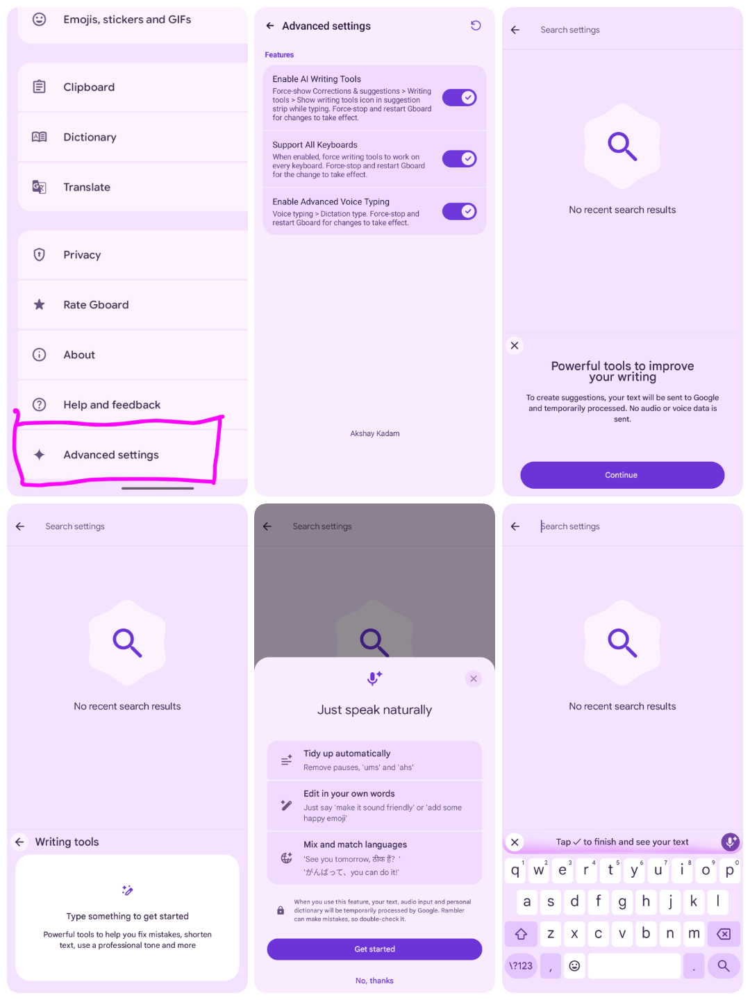

<br><br>

<p align="center">
  <a href="https://github.com/smartworldarafath/Gboard_Pro/releases/download/v18.4.1-Stable-V7/Gboard_Pro-18.4.1-V7.apk">
    <picture>
      <source media="(prefers-color-scheme: dark)" srcset="assets/readme/dark/btn-download.svg">
      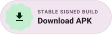
    </picture>
  </a>
  <a href="https://github.com/smartworldarafath/Gboard_Pro/releases/download/v18.4.1-Stable-V7/patches-1.2.0.mpp">
    <picture>
      <source media="(prefers-color-scheme: dark)" srcset="assets/readme/dark/btn-mpp.svg">
      
    </picture>
  </a>
  <a href="https://github.com/smartworldarafath/Gboard_Pro">
    <picture>
      <source media="(prefers-color-scheme: dark)" srcset="assets/readme/dark/btn-github.svg">
      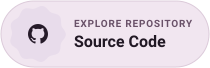
    </picture>
  </a>
  <a href="#support">
    <picture>
      <source media="(prefers-color-scheme: dark)" srcset="assets/readme/dark/btn-sponsor.svg">
      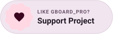
    </picture>
  </a>
</p>

<p align="center">
  <a href="#install" title="Zero Root Required"><picture><source media="(prefers-color-scheme: dark)" srcset="assets/readme/dark/badge-nonroot.svg"></picture></a>
  <a href="https://github.com/smartworldarafath/Gboard_Pro/releases/tag/v18.4.1-Stable-V7" title="Latest Release v18.4.1-V7"><picture><source media="(prefers-color-scheme: dark)" srcset="assets/readme/dark/badge-version.svg"></picture></a>
  <a href="#specs" title="Android 10 - 16 Compatibility"><picture><source media="(prefers-color-scheme: dark)" srcset="assets/readme/dark/badge-android.svg"></picture></a>
  <a href="#specs" title="arm64-v8a Architecture"><picture><source media="(prefers-color-scheme: dark)" srcset="assets/readme/dark/badge-arm64.svg"></picture></a>
  <a href="#dictation" title="Gemini Rambler Voice Dictation"><picture><source media="(prefers-color-scheme: dark)" srcset="assets/readme/dark/badge-rambler.svg"></picture></a>
  <a href="#writing" title="AI Writing Tools"><picture><source media="(prefers-color-scheme: dark)" srcset="assets/readme/dark/badge-ai.svg"></picture></a>
  <a href="#features" title="Material 3 Belka Keys"><picture><source media="(prefers-color-scheme: dark)" srcset="assets/readme/dark/badge-m3e.svg"></picture></a>
  <a href="#specs" title="Coexists with Stock Gboard"><picture><source media="(prefers-color-scheme: dark)" srcset="assets/readme/dark/badge-coexist.svg"></picture></a>
  <a href="LICENSE" title="GPL-3.0 License"><picture><source media="(prefers-color-scheme: dark)" srcset="assets/readme/dark/badge-gpl.svg"></picture></a>
</p>

</div>

<h3 id="overview">
  <picture>
    <source media="(prefers-color-scheme: dark) and (max-width: 640px)" srcset="assets/readme/dark/hm-overview.svg">
    <source media="(prefers-color-scheme: dark)" srcset="assets/readme/dark/h-overview.svg">
    <source media="(max-width: 640px)" srcset="assets/readme/light/hm-overview.svg">
    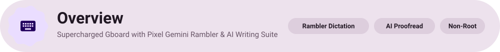
  </picture>
</h3>

**Gboard_Pro** is an open-source enhancement of Google's flagship Android keyboard, re-engineered for discerning typists who demand cutting-edge intelligence, tactile aesthetics, and zero ecosystem friction.

By decoupling Google's flagship features from carrier restrictions, geographical flags, and server-side A/B rollouts, Gboard_Pro unlocks **Pixel Gemini Rambler Conversational Dictation**, **On-Device AI Writing Tools & Tone Rewriting**, **Material 3 Expressive Belka Pill Keycaps**, **Android 12+ Inline Spell Check Chips**, **CameraX OCR Scanner**, and **OEM Clipboard Persistence**—out of the box, with **zero root access required**.

Because **Gboard_Pro** operates under an isolated application namespace (`com.akshaykadam.pixelboard`), it coexists harmoniously alongside your pre-installed system keyboard without replacing or conflicting with stock packages.

<table width="100%">
  <thead>
    <tr>
      <th align="left" width="28%">Quick Facts</th>
      <th align="left">Details</th>
    </tr>
  </thead>
  <tbody>
    <tr><td><b>Application Name</b></td><td><b>Gboard_Pro</b> (Enhanced Android Keyboard)</td></tr>
    <tr><td><b>Current Release</b></td><td><code>v18.4.1-V7</code> (Patch Engine: <code>v1.2.0</code>)</td></tr>
    <tr><td><b>Upstream Base</b></td><td>Google Gboard <code>v18.4.1.985164140-release-arm64-v8a</code></td></tr>
    <tr><td><b>Coexistence Package</b></td><td><code>com.akshaykadam.pixelboard</code> (Runs alongside stock Gboard)</td></tr>
    <tr><td><b>Android Compatibility</b></td><td>Android 10 (API 29) through Android 16</td></tr>
    <tr><td><b>Target CPU ABI</b></td><td><code>arm64-v8a</code> (Modern 64-bit Android Devices)</td></tr>
    <tr><td><b>Root Requirement</b></td><td><b>Zero Root Required</b> — Installs as standard user APK</td></tr>
    <tr><td><b>Design Language</b></td><td>Google Material 3 Expressive (Belka Pill Keycaps & Dynamic Theming)</td></tr>
    <tr><td><b>Core AI Capabilities</b></td><td>Gemini Rambler Speech Cleanup, AI Proofread, Tone Switcher, Camera OCR</td></tr>
    <tr><td><b>License</b></td><td>GNU General Public License v3.0 (100% Free & Open Source)</td></tr>
  </tbody>
</table>

<div align="center">

| Action | Direct Link |
| :--- | :--- |
| **Download Stable APK** | [Gboard_Pro-18.4.1-V7.apk (127 MB)](https://github.com/smartworldarafath/Gboard_Pro/releases/download/v18.4.1-Stable-V7/Gboard_Pro-18.4.1-V7.apk) |
| **Download Morphe Patch Pack** | [patches-1.2.0.mpp (1.6 MB)](https://github.com/smartworldarafath/Gboard_Pro/releases/download/v18.4.1-Stable-V7/patches-1.2.0.mpp) |
| **GitHub Repository** | [smartworldarafath/Gboard_Pro](https://github.com/smartworldarafath/Gboard_Pro) |
| **Submit an Issue** | [GitHub Issues Tracker](https://github.com/smartworldarafath/Gboard_Pro/issues) |
| **Support Developer** | [SupportKori](https://www.supportkori.com/arafathrahman) · [GitHub Sponsors](https://github.com/sponsors/smartworldarafath) · [nsave / RedotPay](#support) |
| **License Details** | [GNU GPL-3.0](LICENSE) |

<br>

<p align="center">
  <a href="https://github.com/smartworldarafath/Gboard_Pro/issues">
    <picture>
      <source media="(prefers-color-scheme: dark)" srcset="assets/readme/dark/btn-issues.svg">
      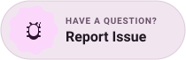
    </picture>
  </a>
  &nbsp;
  <a href="#support">
    <picture>
      <source media="(prefers-color-scheme: dark)" srcset="assets/readme/dark/btn-sponsor.svg">
      
    </picture>
  </a>
  &nbsp;
  <a href="LICENSE">
    <picture>
      <source media="(prefers-color-scheme: dark)" srcset="assets/readme/dark/btn-license.svg">
      
    </picture>
  </a>
</p>

</div>

<h3 id="downloads">
  <picture>
    <source media="(prefers-color-scheme: dark) and (max-width: 640px)" srcset="assets/readme/dark/hm-downloads.svg">
    <source media="(prefers-color-scheme: dark)" srcset="assets/readme/dark/h-downloads.svg">
    <source media="(max-width: 640px)" srcset="assets/readme/light/hm-downloads.svg">
    
  </picture>
</h3>

<table width="100%">
  <thead>
    <tr>
      <th align="left" width="30%">Artifact</th>
      <th align="left" width="22%">Format</th>
      <th align="left">Description & Usage</th>
    </tr>
  </thead>
  <tbody>
    <tr>
      <td><a href="https://github.com/smartworldarafath/Gboard_Pro/releases/download/v18.4.1-Stable-V7/Gboard_Pro-18.4.1-V7.apk"><b>Gboard_Pro-18.4.1-V7.apk</b></a></td>
      <td><b>Signed APK</b><br/><i>(127 MB)</i></td>
      <td><b>Plug-and-play installer (Recommended).</b> Pre-compiled and signed. Installs alongside factory Gboard without conflicts (<code>com.akshaykadam.pixelboard</code>).</td>
    </tr>
    <tr>
      <td><a href="https://github.com/smartworldarafath/Gboard_Pro/releases/download/v18.4.1-Stable-V7/patches-1.2.0.mpp"><b>patches-1.2.0.mpp</b></a></td>
      <td><b>Morphe Patch Archive</b><br/><i>(1.6 MB)</i></td>
      <td>Modular patch package for <a href="#method-3-patch-on-device-with-morphe-manager">Morphe Manager</a> if you prefer building and signing your own APK directly on your phone.</td>
    </tr>
    <tr>
      <td><a href="https://www.apkmirror.com/apk/google-inc/gboard/gboard-the-google-keyboard-18-4-1-985164140-release/" target="_blank" rel="noopener noreferrer"><b>Official Gboard v18.4.1 Base</b></a></td>
      <td><b>Unmodified APK</b><br/><i>(APKMirror)</i></td>
      <td>Clean upstream Google APK. Only required if you are executing the patching pipeline manually on-device or via terminal CLI.</td>
    </tr>
  </tbody>
</table>

> [!TIP]
> **Fastest Setup**: Download [**Gboard_Pro-18.4.1-V7.apk**](https://github.com/smartworldarafath/Gboard_Pro/releases/download/v18.4.1-Stable-V7/Gboard_Pro-18.4.1-V7.apk), tap install, and activate it under **Settings > System > Languages & input**. No root or ADB needed!

<h3 id="showcase">
  <picture>
    <source media="(prefers-color-scheme: dark) and (max-width: 640px)" srcset="assets/readme/dark/hm-showcase.svg">
    <source media="(prefers-color-scheme: dark)" srcset="assets/readme/dark/h-showcase.svg">
    <source media="(max-width: 640px)" srcset="assets/readme/light/hm-showcase.svg">
    
  </picture>
</h3>

<div align="center">
  
  <p><sub><b>Material 3 Expressive Design in Action:</b> Belka rounded keycap geometry, Gemini Rambler voice transcription, AI suggestions strip, and non-root coexistence.</sub></p>
</div>

<h3 id="features">
  <picture>
    <source media="(prefers-color-scheme: dark) and (max-width: 640px)" srcset="assets/readme/dark/hm-features.svg">
    <source media="(prefers-color-scheme: dark)" srcset="assets/readme/dark/h-features.svg">
    <source media="(max-width: 640px)" srcset="assets/readme/light/hm-features.svg">
    
  </picture>
</h3>

<div align="center">

| | |
|:---:|:---:|
| <a href="#dictation" title="Gemini Rambler Conversational Voice Dictation"><picture><source media="(prefers-color-scheme: dark)" srcset="assets/readme/dark/card-rambler.svg">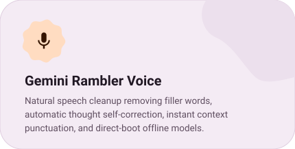</picture></a> | <a href="#writing" title="In-Line AI Writing Suite & Tone Rewriting"><picture><source media="(prefers-color-scheme: dark)" srcset="assets/readme/dark/card-ai.svg">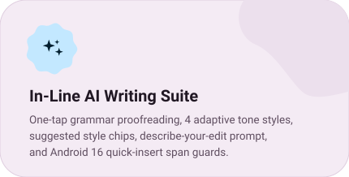</picture></a> |
| <a href="#features-spellcheck" title="Modern Spell Checker Chips & Grammar Engine"><picture><source media="(prefers-color-scheme: dark)" srcset="assets/readme/dark/card-spellcheck.svg">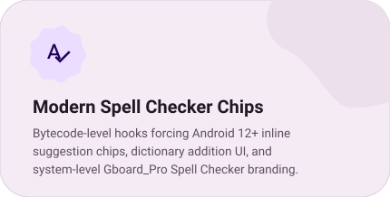</picture></a> | <a href="#features-camera" title="Scan Text Camera OCR & Screenshot Chips"><picture><source media="(prefers-color-scheme: dark)" srcset="assets/readme/dark/card-camera.svg"></picture></a> |
| <a href="#features-belka" title="Material 3 Belka Expressive Pill Keycaps"><picture><source media="(prefers-color-scheme: dark)" srcset="assets/readme/dark/card-belka.svg">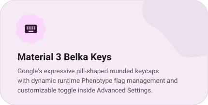</picture></a> | <a href="#features-emoji" title="Emoji Palette V2 & Crisp Full Alpha Scaling"><picture><source media="(prefers-color-scheme: dark)" srcset="assets/readme/dark/card-emoji.svg">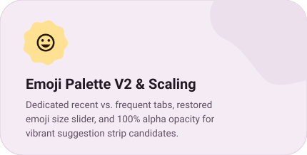</picture></a> |
| <a href="#features-superinsert" title="Super Insert Hub & Cross-App Smart Compose"><picture><source media="(prefers-color-scheme: dark)" srcset="assets/readme/dark/card-superinsert.svg">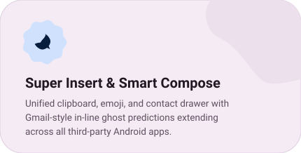</picture></a> | <a href="#features-clipboard" title="OEM Clipboard Sync & Fast Vocabulary Learning"><picture><source media="(prefers-color-scheme: dark)" srcset="assets/readme/dark/card-clipboard.svg">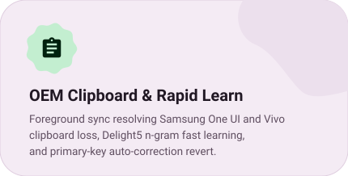</picture></a> |

</div>

<h3 id="dictation">
  <picture>
    <source media="(prefers-color-scheme: dark) and (max-width: 640px)" srcset="assets/readme/dark/hm-dictation.svg">
    <source media="(prefers-color-scheme: dark)" srcset="assets/readme/dark/h-dictation.svg">
    <source media="(max-width: 640px)" srcset="assets/readme/light/hm-dictation.svg">
    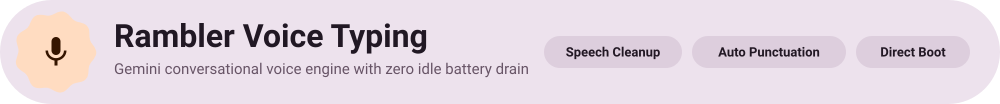
  </picture>
</h3>

Conventional speech recognition blindly transcribes every verbal pause, throat clear, and misstep. **Gboard_Pro** activates Google's state-of-the-art **Rambler** conversational voice engine:

* **Automatic Speech Filler Elimination**: Speak completely naturally. Hesitations like *"uh"*, *"um"*, *"er"*, and *"you know"* are filtered out dynamically in real time.
* **On-the-Fly Thought Correction**: If you change your phrasing mid-sentence (e.g. *"let's meet at 4 actually make it 5"*), Rambler automatically rectifies the text to match your intended thought.
* **Context-Driven Punctuation & Capitalization**: Automatically places commas, periods, question marks, and uppercase acronyms based on vocal cadence and syntactic context.
* **Seamless Code-Switching**: Transition between languages within a single continuous thought without manually switching keyboard layouts.
* **Hardwired for v18.4.1**: Directly integrated into `VoiceSettingsFragment` with `enable_jetson = true` by default, eliminating reliance on Google Play Phenotype rollout flags.
* **Zero Idle Drain**: Disengages `GoogleAsrService` IPC bindings the millisecond the keyboard dismisses, ensuring zero background battery drain while your device rests.
* **Direct Boot Ready**: Key settings reside in Android's Device-Protected Storage, allowing dictation to operate instantly after boot before the first phone unlock.

<h3 id="writing">
  <picture>
    <source media="(prefers-color-scheme: dark) and (max-width: 640px)" srcset="assets/readme/dark/hm-writing.svg">
    <source media="(prefers-color-scheme: dark)" srcset="assets/readme/dark/h-writing.svg">
    <source media="(max-width: 640px)" srcset="assets/readme/light/hm-writing.svg">
    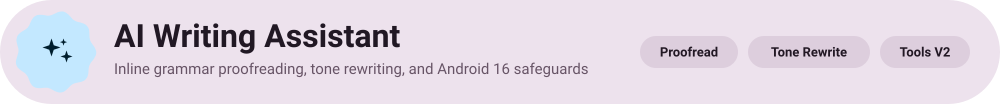
  </picture>
</h3>

Bring Gemini-grade text synthesis directly into any input field on your Android device:

* **Instant In-Line Proofreading**: Tap the sparkle pen (`✨`) on the suggestion strip to detect grammatical nuances, typos, and awkward phrasing instantly.
* **Adaptive Tone Presets**: Seamlessly rewrite sentences into *Professional*, *Casual*, *Concise*, or *Emotive* styles to match your recipient.
* **Android 16 Span Safeguards**: Incorporates null-safe span handling to prevent potential system crashes when expanding suggestion chips on Android 16 previews.
* **Universal Layout Compatibility**: Unlocked across all localized keyboard layouts—not restricted to US English.

> [!NOTE]
> **On-Device Hardware Capabilities**: Features that require local Gemini Nano weights—namely **Writing Tools V2** and the **On-Device AICore / Astrea Backend**—require compatible **Google Pixel hardware** (Pixel 8 Pro, Pixel 9 series, or newer). On non-Pixel hardware, these menus stay unobtrusive, while **Rambler Voice Typing**, **Cloud AI Proofreading/Rewriting**, **Inline Spell Check Chips**, and **Camera OCR** function flawlessly across all Android 10–16 devices.

<h3 id="setup">
  <picture>
    <source media="(prefers-color-scheme: dark) and (max-width: 640px)" srcset="assets/readme/dark/hm-setup.svg">
    <source media="(prefers-color-scheme: dark)" srcset="assets/readme/dark/h-setup.svg">
    <source media="(max-width: 640px)" srcset="assets/readme/light/hm-setup.svg">
    
  </picture>
</h3>

#### 1. Enabling Rambler Voice Dictation
1. **Open Gboard_Pro Settings**: Tap the **Settings (`⚙️`)** cog on the keyboard toolbar, or navigate to **Settings > System > Languages & input > On-screen keyboard > Gboard_Pro**.
2. **Select Rambler Engine**: Tap **Voice typing > Dictation type**, and switch from *Standard* to **Rambler**.
3. **Dictate Immediately**: Tap the microphone icon in any text field, acknowledge the *"Just speak naturally"* prompt once, and speak freely.

#### 2. Activating the AI Writing Assistant
1. **Verify Advanced Toggles**: Open **★ Advanced settings** at the bottom of Gboard_Pro preferences.
2. Confirm that **Enable AI Writing Tools** and **Support All Keyboards** are switched **ON** (enabled by default).
3. Under **Corrections & suggestions > Writing tools**, verify the toolbar shortcut is enabled.
4. **Transform Your Text**: Type a sentence in any app and tap the **Sparkle Pen (`✨`)** to proofread or restyle your draft.

<h3 id="install">
  <picture>
    <source media="(prefers-color-scheme: dark) and (max-width: 640px)" srcset="assets/readme/dark/hm-install.svg">
    <source media="(prefers-color-scheme: dark)" srcset="assets/readme/dark/h-install.svg">
    <source media="(max-width: 640px)" srcset="assets/readme/light/hm-install.svg">
    
  </picture>
</h3>

#### Method 1: Direct APK Installation (Fastest)
1. Download [**Gboard_Pro-18.4.1-V7.apk**](https://github.com/smartworldarafath/Gboard_Pro/releases/download/v18.4.1-Stable-V7/Gboard_Pro-18.4.1-V7.apk).
2. Open the file on your device and tap **Install**.
3. Enable **Gboard_Pro** in **Settings > System > Languages & input > On-screen keyboard**.

#### Method 2: Sideload via ADB
```bash
adb install -r Gboard_Pro-18.4.1-V7.apk
adb shell am force-stop com.akshaykadam.pixelboard
```

#### Method 3: Patch On-Device with Morphe Manager
1. Install **Morphe Manager** on your Android device.
2. Download the [**Gboard_Pro.mpp**](https://github.com/smartworldarafath/Gboard_Pro/raw/main/patches/Gboard_Pro.mpp) patch archive and the unmodified [**Gboard v18.4.1 APK**](https://www.apkmirror.com/apk/google-inc/gboard/gboard-the-google-keyboard-18-4-1-985164140-release/).
3. Select the clean APK, load `Gboard_Pro.mpp`, and tap **Patch**.

> [!TIP]
> **Automatic In-App Updates**: In Morphe Manager settings, add this custom bundle URL to receive automated patch updates:
> ```text
> https://raw.githubusercontent.com/smartworldarafath/Gboard_Pro/main/patches-bundle.json
> ```

<h3 id="stack">
  <picture>
    <source media="(prefers-color-scheme: dark) and (max-width: 640px)" srcset="assets/readme/dark/hm-stack.svg">
    <source media="(prefers-color-scheme: dark)" srcset="assets/readme/dark/h-stack.svg">
    <source media="(max-width: 640px)" srcset="assets/readme/light/hm-stack.svg">
    
  </picture>
</h3>

<div align="center">

<p align="center">
  <picture><source media="(prefers-color-scheme: dark)" srcset="assets/readme/dark/pill-kotlin.svg"></picture>
  <picture><source media="(prefers-color-scheme: dark)" srcset="assets/readme/dark/pill-java.svg"></picture>
  <picture><source media="(prefers-color-scheme: dark)" srcset="assets/readme/dark/pill-android.svg"></picture>
  <picture><source media="(prefers-color-scheme: dark)" srcset="assets/readme/dark/pill-smali.svg"></picture>
  <picture><source media="(prefers-color-scheme: dark)" srcset="assets/readme/dark/pill-morphe.svg"></picture>
  <picture><source media="(prefers-color-scheme: dark)" srcset="assets/readme/dark/pill-gradle.svg"></picture>
  <picture><source media="(prefers-color-scheme: dark)" srcset="assets/readme/dark/pill-camerax.svg"></picture>
  <picture><source media="(prefers-color-scheme: dark)" srcset="assets/readme/dark/pill-m3e.svg"></picture>
  <picture><source media="(prefers-color-scheme: dark)" srcset="assets/readme/dark/pill-de.svg"></picture>
</p>

</div>

#### Repository Structure

```text
Gboard_Pro/
├── README.md                  # Material 3 Expressive documentation & guides
├── build.sh                   # Automated offline build & patching runner
├── options.json               # Default patch configuration & package mapping
├── patches-bundle.json        # Remote bundle manifest for Morphe Manager
├── patches/
│   └── Gboard_Pro.mpp         # Pre-compiled Morphe bytecode patch archive
├── input/
│   └── gboard.apk             # Clean upstream Gboard v18.4.1 APK
├── output/
│   ├── Gboard_Pro.apk         # Signed output APK
│   └── patching-result.json   # Build diagnostics & patch report
├── tools/
│   ├── patcher.jar            # CLI patch execution engine (Java 21+)
│   └── morphe-data/           # Local signing keystores & workspace cache
└── pixelboard-patches/        # Kotlin bytecode transforms & extensions
    ├── patches/               # Morphe bytecode, smali & resource patches
    └── extensions/            # Injected runtime classes & Material You UI
```

#### Compiling from Source

```bash
# 1. Offline APK Patching (Requires input/gboard.apk)
./build.sh

# 2. Recompile the Morphe Patch Archive (.mpp)
./build.sh --rebuild

# 3. Execute Contract & Unit Test Suite
cd pixelboard-patches
./gradlew test
```

<h3 id="specs">
  <picture>
    <source media="(prefers-color-scheme: dark) and (max-width: 640px)" srcset="assets/readme/dark/hm-specs.svg">
    <source media="(prefers-color-scheme: dark)" srcset="assets/readme/dark/h-specs.svg">
    <source media="(max-width: 640px)" srcset="assets/readme/light/hm-specs.svg">
    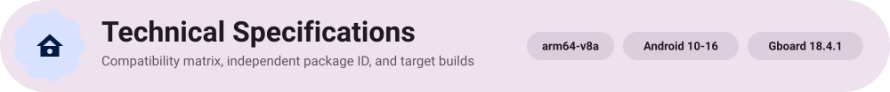
  </picture>
</h3>

<table width="100%">
  <thead>
    <tr>
      <th align="left" width="30%">Specification</th>
      <th align="left">Target Parameter</th>
    </tr>
  </thead>
  <tbody>
    <tr><td><b>Upstream Target Base</b></td><td><code>com.google.android.inputmethod.latin</code></td></tr>
    <tr><td><b>Isolated Package ID</b></td><td><code>com.akshaykadam.pixelboard</code> (Label: <b>Gboard_Pro</b>)</td></tr>
    <tr><td><b>Primary Supported Build</b></td><td><code>18.4.1.985164140-release-arm64-v8a</code></td></tr>
    <tr><td><b>Fallback Supported Builds</b></td><td><code>18.3.1.977415014-release-arm64-v8a</code> / <code>18.3.1-beta</code></td></tr>
    <tr><td><b>Processor ABI</b></td><td><code>arm64-v8a</code> (64-bit ARM)</td></tr>
    <tr><td><b>Supported Android Versions</b></td><td>Android 10 (API 29) through Android 16</td></tr>
    <tr><td><b>Root Requirement</b></td><td><b>Zero Root Required</b></td></tr>
    <tr><td><b>Localization</b></td><td>20+ Languages (English, Arabic, Spanish, French, German, Hindi, Japanese, Bengali, etc.)</td></tr>
  </tbody>
</table>

<h3 id="faq">
  <picture>
    <source media="(prefers-color-scheme: dark) and (max-width: 640px)" srcset="assets/readme/dark/hm-faq.svg">
    <source media="(prefers-color-scheme: dark)" srcset="assets/readme/dark/h-faq.svg">
    <source media="(max-width: 640px)" srcset="assets/readme/light/hm-faq.svg">
    
  </picture>
</h3>

**Does Gboard_Pro require root access or bootloader unlocking?**  
No. Gboard_Pro is built to install seamlessly as a standard Android application without requiring root, Magisk, KernelSU, or system partition modification.

**Will installing Gboard_Pro overwrite my existing system Gboard?**  
No. Because Gboard_Pro uses an independent application package identifier (`com.akshaykadam.pixelboard`), it lives comfortably side-by-side with your device's stock Google Keyboard. You can switch between them at any time in system settings.

**Are my keystrokes, clipboard, and personal dictation private?**  
Yes. Gboard_Pro strips out promotional telemetry and third-party trackers. All custom options and voice models utilize Android's Device-Protected Storage. On-device dictation and clipboard data remain strictly within your device boundaries.

**Do I need a Google Pixel device to use Rambler voice dictation?**  
No! While stock Google Gboard restricts Rambler to Pixel 8 Pro and Pixel 9 series devices, Gboard_Pro unlocks Rambler speech recognition across **all Android 10–16 devices** powered by modern ARM64 processors.

<h3 id="support">
  <picture>
    <source media="(prefers-color-scheme: dark) and (max-width: 640px)" srcset="assets/readme/dark/hm-support.svg">
    <source media="(prefers-color-scheme: dark)" srcset="assets/readme/dark/h-support.svg">
    <source media="(max-width: 640px)" srcset="assets/readme/light/hm-support.svg">
    
  </picture>
</h3>

**Gboard_Pro** is 100% free and open-source under the GNU General Public License v3.0. If Gboard_Pro elevates your typing workflow or brings new life to your Android device, please consider supporting ongoing maintenance and updates:

<div align="center">

<table>
  <tr>
    <td align="center" width="25%" valign="top">
      <h4> SupportKori</h4>
      <a href="https://www.supportkori.com/arafathrahman" target="_blank" rel="noopener noreferrer">
        
      </a><br/><br/>
      <a href="https://www.supportkori.com/arafathrahman" target="_blank" rel="noopener noreferrer">
        
      </a><br/>
      <sub>bKash · Nagad · Cards · Global</sub>
    </td>
    <td align="center" width="25%" valign="top">
      <h4> nsave</h4>
      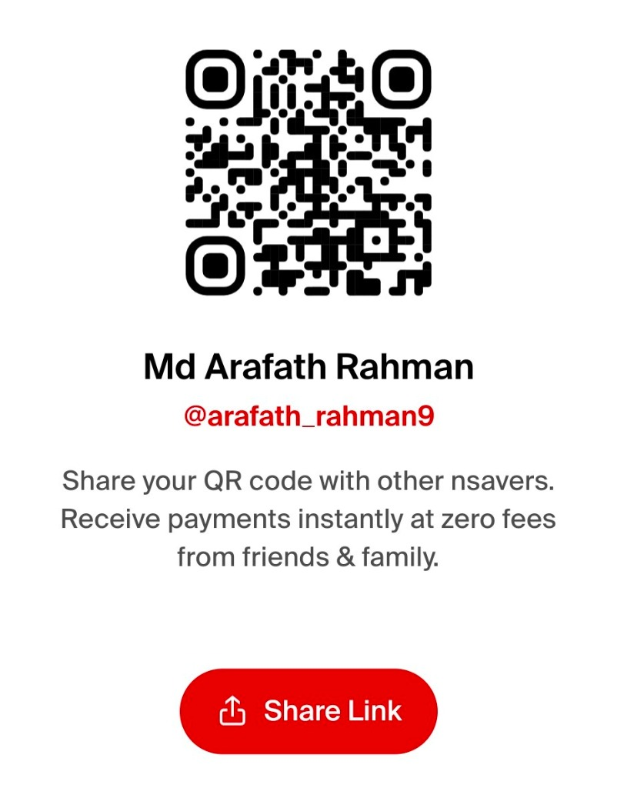<br/><br/>
      <br/>
      <sub>Ntag: <code>@arafath_rahman9</code></sub>
    </td>
    <td align="center" width="25%" valign="top">
      <h4> RedotPay</h4>
      <br/><br/>
      <br/>
      <sub>ID: <code>1965421414</code></sub>
    </td>
    <td align="center" width="25%" valign="top">
      <h4> Payoneer</h4>
      <br/><br/>
      <a href="mailto:arafathrahman710@gmail.com?subject=Support%20Gboard_Pro%20via%20Payoneer">
        
      </a><br/>
      <sub>Email: <code>arafathrahman710@gmail.com</code></sub>
    </td>
  </tr>
</table>

<br>

| Method | Account Details & Links |
| :--- | :--- |
| **SupportKori** | [supportkori.com/arafathrahman](https://www.supportkori.com/arafathrahman) *(bKash, Nagad, Visa, Mastercard, AMEX)* |
| **GitHub Sponsors** | [github.com/sponsors/smartworldarafath](https://github.com/sponsors/smartworldarafath) |
| **nsave** | Ntag: `@arafath_rahman9` · Name: `Md Arafath Rahman` |
| **RedotPay** | Account ID: `1965421414` |
| **Payoneer** | Email: `arafathrahman710@gmail.com` · Customer ID: `70366820` |

<br><br>

### 👥 Maintainers & Contributors

<table>
  <tr>
    <td align="center" width="50%">
      <a href="https://github.com/smartworldarafath">
        <br />
        <sub><b>Arafath Rahman</b></sub>
      </a><br />
      <sub>Maintainer & Lead Developer</sub>
    </td>
    <td align="center" width="50%">
      <a href="https://github.com/anthropics">
        <br />
        <sub><b>Claude</b></sub>
      </a><br />
      <sub>AI Pair Programmer & Co-Developer</sub>
    </td>
  </tr>
</table>

</div>

<h3 id="license">
  <picture>
    <source media="(prefers-color-scheme: dark) and (max-width: 640px)" srcset="assets/readme/dark/hm-license.svg">
    <source media="(prefers-color-scheme: dark)" srcset="assets/readme/dark/h-license.svg">
    <source media="(max-width: 640px)" srcset="assets/readme/light/hm-license.svg">
    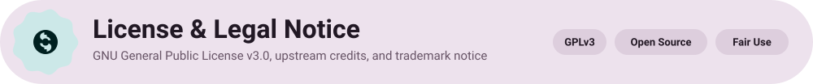
  </picture>
</h3>

> [!CAUTION]
> **READ CAREFULLY BEFORE INSTALLING OR COMPILING THIS PROJECT.**

1. **Independent Modification**: **Gboard_Pro** is an independent, non-commercial open-source research and interoperability project. It is **not** affiliated with, maintained by, or endorsed by **Google LLC**.
2. **Trademark Notice**: "Google", "Gboard", "Pixel", "Android", and "Gemini" are trademarks of Google LLC. All references are made strictly for technological compatibility and descriptive identification under fair use principles.
3. **No Warranty**: Gboard_Pro is distributed under the **GNU General Public License v3.0** in the hope that it will be useful, but **WITHOUT ANY WARRANTY**; without even the implied warranty of MERCHANTABILITY or FITNESS FOR A PARTICULAR PURPOSE. See the [LICENSE](LICENSE) file for complete terms.
